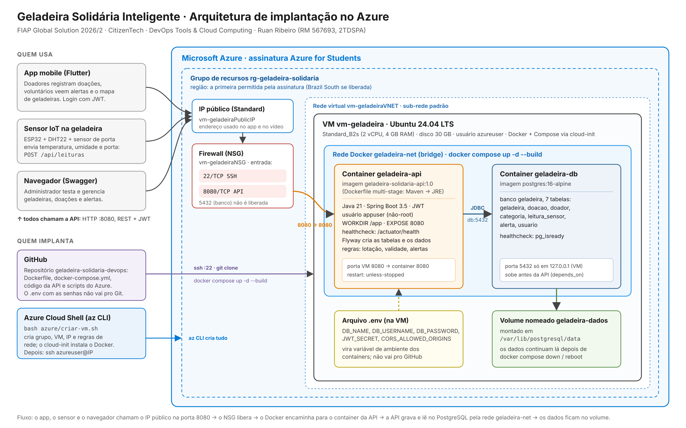

# Geladeira Solidária Inteligente: DevOps e Cloud

**Global Solution 2026/2 · CitizenTech · FIAP, 2º ano de ADS**
**Disciplina:** DevOps Tools & Cloud Computing

| Integrante | RM | Turma |
|---|---|---|
| Ruan Ribeiro | 567693 | 2TDSPA |

**Vídeo de demonstração:** https://youtu.be/wZetgJfhDLk

---

## 1. A solução

Geladeiras solidárias ficam em espaços públicos: comércios e moradores deixam alimentos e qualquer pessoa retira o que precisa. Ninguém sabe, de longe, se a refrigeração falhou, o que está vencendo ou quais geladeiras estão lotadas enquanto outras estão vazias.

A **Geladeira Solidária Inteligente** junta sensores IoT em cada geladeira, uma API Java que aplica as regras de segurança alimentar (lotação, validade, temperatura, alertas) e um app para doadores e voluntários.

Este repositório coloca a **API Java + PostgreSQL** para rodar em **containers Docker numa VM Linux no Azure**, criada por script com o Azure CLI.

**ODS:** 2 (Fome zero), 3 (Saúde e bem-estar), 10 (Redução das desigualdades) e 11 (Cidades e comunidades sustentáveis).

## 2. Arquitetura



| Peça | O que é | Por quê |
|---|---|---|
| **VM `vm-geladeira`** | Ubuntu 24.04 LTS, Standard_B2s (2 vCPU, 4 GB), criada pelo `azure/criar-vm.sh` | 4 GB aguentam a API Java e o Postgres juntos com folga. Docker e Compose são instalados no primeiro boot pelo `cloud-init.yaml`. |
| **NSG (firewall)** | Libera só as portas 22 (SSH) e 8080 (API) | O banco (5432) não fica exposto na internet. |
| **Container `geladeira-api`** | Imagem própria `geladeira-solidaria-api:1.0`, gerada pelo `Dockerfile` | Spring Boot 3.5 com Java 21, rodando com um usuário sem privilégios. |
| **Container `geladeira-db`** | Imagem oficial `postgres:16-alpine` | Banco relacional da API. As tabelas são criadas pelo Flyway quando a API sobe. |
| **Rede `geladeira-net`** | Rede bridge do Docker | A API encontra o banco pelo nome do serviço (`db:5432`), sem IP fixo. |
| **Volume `geladeira-dados`** | Volume nomeado montado em `/var/lib/postgresql/data` | Os dados continuam lá depois de `docker compose down`, de reiniciar a VM ou de recriar o container. |
| **`.env`** | Senhas e chave do JWT | Fica só na VM, nunca no GitHub (`.gitignore`). O modelo é o `.env.example`. |

## 3. Estrutura do repositório

```
geladeira-solidaria-devops/
├── api/                    código da API Java (Spring Boot + Maven)
├── azure/
│   ├── criar-vm.sh         script Azure CLI: grupo, VM, IP, NSG
│   ├── cloud-init.yaml     instala Docker, Compose e Git no primeiro boot
│   └── remover-recursos.sh desliga, liga ou apaga a VM
├── docs/
│   ├── arquitetura.png     desenho da arquitetura
│   └── arquitetura.svg     mesmo desenho, editável
├── Dockerfile              imagem da API (multi-stage, usuário não-root)
├── docker-compose.yml      API + PostgreSQL, rede, volume, portas e variáveis
├── .env.example            modelo das variáveis (copiar para .env)
└── .dockerignore / .gitignore / .gitattributes
```

## 4. Dockerfile

Build em **dois estágios**:

1. **`build`** (`maven:3.9-eclipse-temurin-21`): compila o projeto e gera o `.jar`. O Maven e o JDK ficam só nesse estágio.
2. **`runtime`** (`eclipse-temurin:21-jre-alpine`): só o Java de execução e o `.jar`. Assim a imagem final fica bem menor e não leva ferramentas de compilação para produção.

| Requisito | Onde está no Dockerfile |
|---|---|
| **Usuário não-root** | `adduser ... appuser` e `USER appuser`. O `docker exec geladeira-api whoami` responde `appuser`. |
| **WORKDIR** | `WORKDIR /app`: o `.jar` e a pasta `logs` ficam ali. |
| **ENV** | `TZ`, `SERVER_PORT` e `JAVA_OPTS` (limite de memória da JVM). Senhas **não** ficam na imagem: vêm do Compose. |
| **EXPOSE** | `EXPOSE 8080` |
| Extra | `HEALTHCHECK` no `/actuator/health`, então o `docker ps` mostra `(healthy)` |

## 5. docker-compose.yml

| Requisito | Como está |
|---|---|
| **App + banco** | serviços `api` (build do Dockerfile) e `db` (Postgres) |
| **Rede** | `geladeira-net`, bridge, compartilhada pelos dois |
| **Volume nomeado** | `geladeira-dados` → `/var/lib/postgresql/data` |
| **Portas** | API: `8080:8080` (pública). Banco: `127.0.0.1:5432:5432` (só de dentro da VM) |
| **Variáveis** | lidas do `.env`: `DB_NAME`, `DB_USERNAME`, `DB_PASSWORD`, `JWT_SECRET`... A API recebe `DB_URL=jdbc:postgresql://db:5432/...` |
| **depends_on** | a API só sobe quando o banco passa no healthcheck (`condition: service_healthy`) |
| Extra | `restart: unless-stopped`: se a VM reiniciar, os containers voltam sozinhos |

## 6. How To: do zero até a API no ar

### 6.1 Criar a VM (Azure Cloud Shell)

1. Entre em [portal.azure.com](https://portal.azure.com) com a conta **Azure for Students**.
2. Clique no ícone **`>_`** no topo (Cloud Shell) e escolha **Bash**. Se ele perguntar sobre armazenamento, pode escolher a opção sem conta de armazenamento.
3. Rode:

```bash
git clone https://github.com/SEU-USUARIO/geladeira-solidaria-devops.git
cd geladeira-solidaria-devops
bash azure/criar-vm.sh
```

O script descobre sozinho em quais regiões a sua assinatura pode criar recursos, escolhe um tamanho de VM disponível, cria tudo e mostra o **IP público** no final.

> Se der `RequestDisallowedByAzure`, a região não é permitida. Rode de novo escolhendo outra: `REGIAO=eastus2 bash azure/criar-vm.sh`. As regiões liberadas aparecem em *Azure Policy → Atribuições → Allowed resource deployment regions*.

### 6.2 Entrar na VM

Espere uns 2 minutos depois que o script terminar (o cloud-init ainda está instalando o Docker) e, no próprio Cloud Shell:

```bash
ssh azureuser@IP_DA_VM
docker --version && docker compose version     # confere a instalação
```

### 6.3 Subir os containers

```bash
git clone https://github.com/SEU-USUARIO/geladeira-solidaria-devops.git
cd geladeira-solidaria-devops

cp .env.example .env
nano .env        # troque DB_PASSWORD e JWT_SECRET (Ctrl+O, Enter, Ctrl+X)

docker compose up -d --build
docker compose ps
```

O primeiro build leva de 2 a 4 minutos (baixa as dependências do Maven). Quando os dois containers aparecerem como `(healthy)`, a API está pronta:

| O quê | Endereço |
|---|---|
| Swagger | `http://IP_DA_VM:8080/swagger-ui.html` |
| Health | `http://IP_DA_VM:8080/actuator/health` |

Login no Swagger (`POST /auth/login`): `admin@geladeira.test` / `Admin@123`. Copie o `token`, clique em **Authorize** e cole.

### 6.4 Comandos úteis

```bash
docker compose ps                         # containers e status
docker compose logs -f api                # logs da API (Ctrl+C para sair)
docker exec geladeira-api whoami          # appuser (não-root)
docker exec geladeira-api pwd             # /app (WORKDIR)
docker exec geladeira-api ls -la /app     # arquivos da aplicação

# Banco: lista as tabelas e consulta
docker exec -it geladeira-db psql -U geladeira -d geladeira -c "\dt"
docker exec -it geladeira-db psql -U geladeira -d geladeira

docker volume inspect geladeira-dados     # onde o volume está na VM
docker network inspect geladeira-net      # containers ligados na rede

docker compose down                       # para e remove os containers (o volume fica)
docker compose up -d                      # sobe de novo: os dados continuam lá
```

### 6.5 Desligar para não gastar crédito

No Cloud Shell (fora da VM):

```bash
bash azure/remover-recursos.sh desligar   # para a VM (para de cobrar a computação)
bash azure/remover-recursos.sh ligar      # liga de novo
bash azure/remover-recursos.sh apagar     # apaga tudo depois da apresentação
```

## 7. Rodar localmente (opcional)

Com o Docker Desktop instalado, os mesmos comandos funcionam no seu computador:

```bash
cp .env.example .env
docker compose up -d --build
```

Swagger em `http://localhost:8080/swagger-ui.html`. Se aparecer `port is already allocated`, outro Postgres já está usando a porta 5432 no seu computador (por exemplo, o do projeto Java). Pare ele com `docker stop geladeira-postgres` e rode de novo.

## 8. Segurança

- Nenhuma senha real no repositório: o `.env` está no `.gitignore` e o `.env.example` só tem valores de exemplo.
- A API roda com usuário sem privilégios (`appuser`) dentro do container.
- O banco não tem porta aberta para a internet: só a API (8080) e o SSH (22) passam pelo NSG.
- O acesso à VM é por chave SSH, sem senha.

## 9. Uso de IA generativa

Este projeto foi desenvolvido com apoio do Claude (Anthropic) para gerar o Dockerfile, o docker-compose, os scripts do Azure, o desenho da arquitetura e a documentação. Todo o conteúdo foi revisado, executado e testado pelo integrante, que é responsável pelo que foi entregue.
