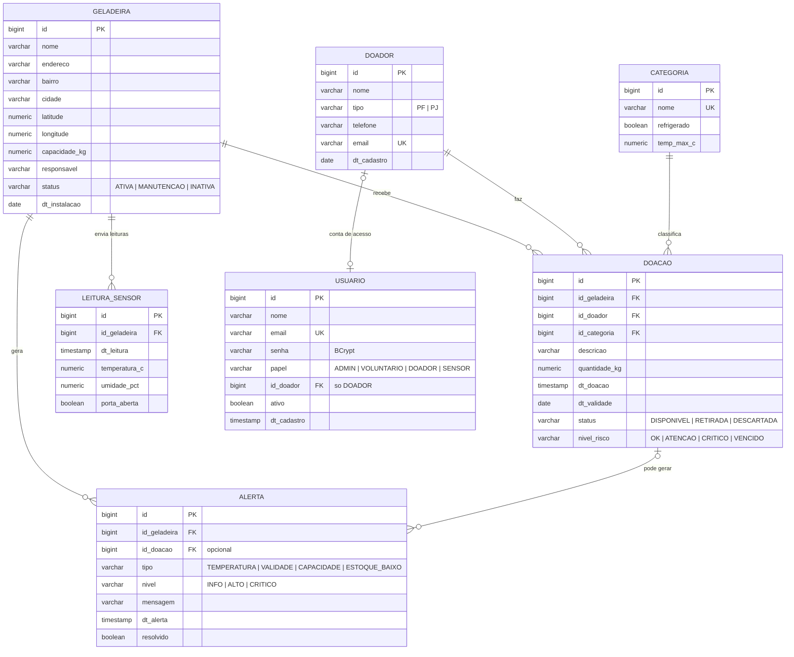

# Geladeira Solidária Inteligente: API (Java + Spring Boot)

**Global Solution 2026/2 · CitizenTech · FIAP, 2º ano de ADS**
**Disciplina:** Java Advanced

| Integrante | RM | Turma |
|---|---|---|
| Ruan Ribeiro | 567693 | 2TDSPA |

**Vídeo pitch:** _colar aqui o link do YouTube (não listado)_

---

## 1. O problema e a solução

Geladeiras solidárias são geladeiras instaladas em espaços públicos onde comércios e moradores deixam alimentos e qualquer pessoa retira o que precisa. Hoje ninguém sabe, em tempo real, se a refrigeração falhou, o que está vencendo ou quais geladeiras estão lotadas enquanto outras, a poucos bairros dali, estão vazias.

Esta API é o centro da solução. Ela recebe as **leituras do sensor IoT** de cada geladeira (temperatura, umidade e porta), registra as **doações** com validade e categoria, e aplica as regras que protegem quem vai comer o alimento:

- recusa doação em geladeira lotada, em manutenção ou quente demais para aquele alimento, e **sugere a geladeira com mais espaço**;
- classifica o **risco de cada alimento** (OK, ATENÇÃO, CRÍTICO, VENCIDO) e descarta o que venceu;
- abre **alertas** para os voluntários (temperatura, validade, capacidade, estoque baixo);
- monta a **lista de distribuição prioritária** do dia.

O app mobile consome esta API: o mapa de geladeiras é público, e doadores, voluntários e administradores entram com login.

**ODS:** 2 (Fome zero), 3 (Saúde e bem-estar), 10 (Redução das desigualdades) e 11 (Cidades e comunidades sustentáveis).

## 2. Tecnologias

Java 21 · Spring Boot 3.5 · Spring Data JPA (Hibernate) · PostgreSQL 16 · Flyway · Bean Validation · Spring Cache · Spring HATEOAS · Spring Security + JWT (jjwt) · BCrypt · Spring Boot Actuator · springdoc-openapi (Swagger) · JUnit 5 + MockMvc · H2 (perfil de demonstração e testes)

## 3. Como rodar

**Pré-requisitos:** Java 21 ou mais recente e Docker (para o PostgreSQL). Não precisa instalar o Maven: o projeto traz o Maven Wrapper (`./mvnw`).

> No Windows, os dois instalam pelo terminal com o winget: `winget install EclipseAdoptium.Temurin.21.JDK` e `winget install Docker.DockerDesktop`. Depois de instalar o Docker Desktop, abra ele uma vez e deixe rodando.

### Opção A: com PostgreSQL (padrão)

```bash
git clone <url-deste-repositorio>
cd geladeira-solidaria-api

docker compose up -d          # sobe o PostgreSQL na porta 5432
./mvnw spring-boot:run        # Linux/macOS
.\mvnw.cmd spring-boot:run    # Windows (PowerShell ou CMD)
```

Na primeira subida o **Flyway** cria as tabelas (`V1__criar_tabelas.sql`) e carrega os dados de teste (`V2__dados_iniciais.sql`). Não é preciso rodar nenhum SQL à mão.

### Opção B: sem Docker (banco H2 em memória)

```bash
./mvnw spring-boot:run -Dspring-boot.run.profiles=h2          # Linux/macOS
.\mvnw.cmd spring-boot:run "-Dspring-boot.run.profiles=h2"    # Windows (PowerShell precisa das aspas)
```

Mesmas migrations e mesmos dados, num banco que some ao desligar a API. O console do H2 fica em `http://localhost:8080/h2-console` (JDBC URL `jdbc:h2:mem:geladeira`, usuário `sa`, senha vazia).

### Endereços

| O quê | URL |
|---|---|
| Swagger (documentação e testes) | http://localhost:8080/swagger-ui.html |
| OpenAPI (JSON) | http://localhost:8080/v3/api-docs |
| Health | http://localhost:8080/actuator/health |
| Info | http://localhost:8080/actuator/info |
| Metrics (só ADMIN) | http://localhost:8080/actuator/metrics |

### Variáveis de ambiente

Nenhuma senha real fica no código. Os valores padrão do `application.yml` são só para rodar localmente; em produção, defina as variáveis (modelo em `.env.example`):

| Variável | Para quê | Padrão local |
|---|---|---|
| `DB_URL` | JDBC do PostgreSQL | `jdbc:postgresql://localhost:5432/geladeira` |
| `DB_USERNAME` / `DB_PASSWORD` | Usuário e senha do banco | os do `docker-compose.yml` |
| `JWT_SECRET` | Chave de assinatura do JWT (mín. 32 caracteres) | segredo de desenvolvimento |
| `JWT_EXPIRATION_MINUTES` | Validade do token | `120` |
| `CORS_ALLOWED_ORIGINS` | Origens liberadas para o app | `*` |

### Testes automatizados

```bash
./mvnw test          # Linux/macOS
.\mvnw.cmd test      # Windows
```

São 14 testes de ponta a ponta (MockMvc + H2) cobrindo login, 401/403 por papel, paginação com HATEOAS, validação, 404, as regras de doação (RN4), o alerta do sensor, o processamento de riscos (RN5), o filtro dinâmico, o ranking JPQL e o Actuator.

## 4. Usuários de teste e permissões

| Papel | E-mail | Senha | O que faz |
|---|---|---|---|
| ADMIN | `admin@geladeira.test` | `Admin@123` | Gerencia a rede: geladeiras, categorias, usuários, métricas |
| VOLUNTARIO | `voluntario@geladeira.test` | `Voluntario@123` | Opera as geladeiras: doações, retiradas, alertas, riscos |
| DOADOR | `doador@geladeira.test` | `Doador@123` | Registra e acompanha as próprias doações |
| SENSOR | `sensor@geladeira.test` | `Sensor@123` | Conta do dispositivo IoT: só envia leituras |

As senhas ficam no banco com **BCrypt**. Novos doadores se cadastram sozinhos em `POST /auth/registrar`; contas de voluntário, admin e sensor são criadas pelo ADMIN em `POST /api/usuarios`.

| Endpoint | Público | DOADOR | VOLUNTARIO | ADMIN | SENSOR |
|---|:-:|:-:|:-:|:-:|:-:|
| `GET` geladeiras, situação, ocupação, categorias | ✓ | ✓ | ✓ | ✓ | ✓ |
| `POST/PUT/DELETE` geladeiras e categorias | | | | ✓ | |
| Doadores (listar, criar, editar) | | | ✓ | ✓ | |
| `GET` doações | | só as suas | ✓ | ✓ | |
| `POST` doações | | em nome próprio | ✓ | ✓ | |
| Retirada, descarte, correção, processar riscos, lista prioritária | | | ✓ | ✓ | |
| Alertas | | | ✓ | ✓ | |
| `POST` leituras do sensor | | | | ✓ | ✓ |
| Usuários e `/actuator/metrics` | | | | ✓ | |

### Testando no Swagger

1. Abra `http://localhost:8080/swagger-ui.html`.
2. Em **Autenticação → POST /auth/login**, clique em *Try it out* e envie um dos usuários acima.
3. Copie o valor de `token`, clique em **Authorize** (cadeado no topo) e cole.
4. Pronto: as próximas chamadas vão com o token. Para trocar de papel, faça login com outro usuário e repita o passo 3.

## 5. Modelo de dados



É o mesmo modelo da disciplina de Banco de Dados (Oracle), adaptado para PostgreSQL, mais a tabela de usuários. Os dados de teste usam datas relativas a `CURRENT_DATE`, então o cenário é o mesmo em qualquer dia: 10 geladeiras em bairros de São Paulo, 10 doadores, 10 categorias, 17 leituras e 29 doações. Nomes, telefones e e-mails são fictícios.

## 6. Endpoints

| Método | Rota | Descrição |
|---|---|---|
| `POST` | `/auth/login` | Login, devolve o JWT |
| `POST` | `/auth/registrar` | Cadastro público de doador |
| `GET` | `/auth/me` | Usuário do token |
| `GET` | `/api/geladeiras` | Lista paginada, filtros `bairro` e `status` |
| `GET` | `/api/geladeiras/{id}` | Detalhe com ocupação (em cache) |
| `GET` | `/api/geladeiras/{id}/situacao` | Situação da geladeira (RN1) |
| `GET` | `/api/geladeiras/{id}/leituras` | Histórico do sensor, paginado |
| `GET` | `/api/geladeiras/ocupacao` | Ranking de ocupação (JPQL) |
| `GET` | `/api/geladeiras/com-espaco?kg=` | Geladeiras que comportam X kg (JPQL) |
| `POST` `PUT` `DELETE` | `/api/geladeiras[/{id}]` | CRUD (ADMIN) |
| `GET` `POST` `PUT` `DELETE` | `/api/categorias[/{id}]` | CRUD de categorias (em cache) |
| `GET` `POST` `PUT` `DELETE` | `/api/doadores[/{id}]` | CRUD de doadores, paginado |
| `GET` | `/api/doacoes` | Filtro dinâmico (Specification), paginado |
| `GET` | `/api/doacoes/{id}` | Detalhe com links de ação |
| `GET` | `/api/doacoes/prioritarias?dias=3` | Lista de distribuição (RN3) |
| `POST` | `/api/doacoes` | Registra doação (RN4) |
| `PUT` | `/api/doacoes/{id}` | Corrige uma doação disponível |
| `PATCH` | `/api/doacoes/{id}/retirada` | Alimento entregue |
| `PATCH` | `/api/doacoes/{id}/descarte` | Alimento descartado |
| `POST` | `/api/doacoes/processar-riscos` | Classificação de riscos (RN5) |
| `DELETE` | `/api/doacoes/{id}` | Apaga doação registrada por engano (ADMIN) |
| `POST` | `/api/leituras` | Leitura do sensor IoT |
| `GET` | `/api/alertas` | Painel de alertas, paginado e filtrável |
| `PATCH` | `/api/alertas/{id}/resolver` | Resolve um alerta |
| `GET` `POST` | `/api/usuarios` | Contas internas (ADMIN) |

**Paginação e ordenação** em toda listagem: `?page=0&size=10&sort=campo,asc`.

## 7. Regras de negócio

| # | Regra | Onde está |
|---|---|---|
| RN1 | **Situação da geladeira**, em ordem de prioridade: fora de operação → sensor sem leitura há mais de 60 min → temperatura média das últimas 24 h acima de 8 °C → ocupação ≥ 90% (lotada) → ocupação ≤ 20% (estoque baixo) → normal. Temperatura vem antes de lotação porque é risco à saúde; lotação é logística. | `GeladeiraService.situacao` |
| RN2 | **Leitura do sensor** acima de 8 °C abre alerta de TEMPERATURA (crítico), sem duplicar enquanto houver um aberto. | `LeituraService.registrar` |
| RN3 | **Lista de distribuição prioritária**: alimentos disponíveis, em geladeiras ativas, que vencem em até N dias, do que vence primeiro ao que vence depois. | `DoacaoRepository.listaDistribuicaoPrioritaria` |
| RN4 | **Registro de doação**: quantidade > 0; alimento não pode chegar vencido; geladeira precisa existir e estar ATIVA; alimento refrigerado não entra em geladeira acima da temperatura máxima da categoria; a doação tem que caber (se não couber, a resposta 422 traz em `sugestao` a geladeira ativa com mais espaço); passou de 90% de ocupação, abre alerta de CAPACIDADE. Um DOADOR só doa em nome próprio. | `DoacaoService.registrar` |
| RN5 | **Classificação de risco**: validade passou → VENCIDO (vira DESCARTADA e abre alerta); refrigerado numa geladeira acima da temperatura máxima da categoria → CRÍTICO; vence hoje ou amanhã → CRÍTICO; vence em 2 ou 3 dias → ATENÇÃO; senão, OK. Roda pelo endpoint e sozinho todo dia às 6h (`@Scheduled`). | `DoacaoService.processarRiscos` |

Os limites (8 °C, 90%, 20%, 60 min) ficam em `app.regras` no `application.yml`.

**Para ver as regras funcionando:** com o banco recém-criado, chame `POST /api/doacoes/processar-riscos` como VOLUNTARIO. A carga inicial tem dois alimentos vencidos (maçãs em Itaquera e queijo no Jardim Ângela) que são descartados, e o leite e as marmitas da Heliópolis (geladeira a 9,8 °C) viram CRÍTICO por temperatura. Depois, `GET /api/alertas?resolvido=false` mostra os alertas abertos.

## 8. Justificativa das consultas

| Tipo | Consulta | Por que esse tipo |
|---|---|---|
| **Query method** | `findByBairroContainingIgnoreCase`, `findByStatus`, `findByBairroContainingIgnoreCaseAndStatus` (geladeiras), `findByNomeContainingIgnoreCase`, `findByTipo` (doadores), `findFirstByGeladeiraIdOrderByDtLeituraDesc` (última leitura), `existsBy...` (checagens antes de excluir e para não duplicar alerta) | Filtros simples, de um ou dois campos. O nome do método já diz o que a consulta faz e o Spring gera o SQL, sem código a manter. |
| **@Query JPQL** | `rankingOcupacao` e `comEspacoLivre` (geladeiras), `somarOcupacaoKg`, `listaDistribuicaoPrioritaria` (doações), `temperaturaMedia` (leituras) | Precisam de **agregação** (`SUM`, `AVG`, `GROUP BY`, `HAVING`), de **LEFT JOIN com condição** (contar só doações DISPONIVEL e ainda listar geladeiras vazias) ou de **JOIN FETCH** para trazer geladeira, categoria e doador numa consulta só. Isso não cabe num nome de método. O ranking devolve uma projeção (`OcupacaoGeladeira`), sem carregar entidades inteiras. |
| **Specification** | `DoacaoSpecs.comFiltro` (doações, 10 filtros) e `AlertaSpecs.comFiltro` (alertas) | São telas de busca em que o usuário combina filtros à vontade (geladeira, doador, categoria, status, risco, bairro, descrição, faixa de validade, só refrigerados). Com query method seriam dezenas de métodos, um por combinação. A Specification monta o `WHERE` só com os filtros que vierem preenchidos. Ex.: `GET /api/doacoes?nivelRisco=CRITICO&refrigerado=true&bairro=helio`. |

Para não cair no problema N+1, as listagens de doações e alertas usam `@EntityGraph`, que traz as entidades relacionadas no mesmo `SELECT`.

## 9. Justificativa do cache

O cache usa `@Cacheable` e `@CacheEvict` com o provedor em memória do Spring (`spring.cache.type=simple`).

| Cache | O que guarda | Por que | Quando é limpo |
|---|---|---|---|
| `categorias` | A lista completa e cada categoria por id | Categorias quase nunca mudam, mas são lidas em todo formulário de doação do app. É o caso clássico de leitura frequente e escrita rara. | Em qualquer criação, edição ou exclusão de categoria (`allEntries = true`, porque a lista inteira muda). |
| `geladeiras` | O detalhe de cada geladeira, com a ocupação calculada | É a tela mais acessada: cada toque no mapa abre um detalhe, e a ocupação exige um `SUM` sobre as doações. | Pela chave da geladeira quando ela é editada ou excluída, e também quando uma doação dela é registrada, corrigida, retirada, descartada ou excluída. O processamento de riscos limpa todas. Assim o cache nunca mostra ocupação velha. |

Listagens paginadas e filtradas **não** ficam em cache: cada combinação de página, filtro e ordenação seria uma entrada diferente, quase sem reaproveitamento. Também não guardamos leituras nem alertas, que mudam o tempo todo.

## 10. HATEOAS

Toda resposta traz `_links` (formato HAL). Além da navegação (`self`, `geladeira`, `doador`, `categoria`, `doacoes`, `leituras`, `alertas`), os links mostram **as ações possíveis no estado atual**:

- uma doação DISPONIVEL traz `retirar` e `descartar`; depois de retirada, esses links somem;
- um alerta aberto traz `resolver`; resolvido, não traz;
- as páginas trazem `first`, `prev`, `next` e `last`.

## 11. Erros

Todos os erros saem no mesmo formato, pelo `@RestControllerAdvice` (`GlobalExceptionHandler`):

```json
{
  "timestamp": "2026-11-10T23:51:03Z",
  "status": 422,
  "erro": "Unprocessable Entity",
  "mensagem": "A doacao de 10 kg nao cabe na geladeira 'Geladeira Solidaria Capao Redondo' (1.00 kg livres)",
  "caminho": "/api/doacoes",
  "sugestao": { "geladeiraId": 7, "nome": "Geladeira Solidaria Itaquera", "livreKg": 68.00 }
}
```

| Status | Quando |
|---|---|
| 400 | Bean Validation (com a lista `campos`), JSON inválido, parâmetro com tipo errado |
| 401 | Sem token, token inválido ou login errado |
| 403 | O papel do usuário não pode fazer a operação |
| 404 | Registro ou rota inexistente |
| 409 | E-mail ou nome duplicado, exclusão de registro com histórico |
| 422 | Regra de negócio (geladeira lotada, em manutenção, quente, doação já retirada...) |
| 500 | Erro inesperado (o detalhe vai para o log, não para o cliente) |

## 12. Requisitos da disciplina

| Requisito | Onde está |
|---|---|
| Entidades JPA relacionadas, CRUD com DTOs, paginação e ordenação | `model/` (7 entidades com `@ManyToOne`/`@OneToMany`/`@OneToOne`), `dto/` (records), `controller/`, `Pageable` em todas as listagens |
| Query method, `@Query` JPQL e filtro dinâmico com Specification | `repository/` (seção 8) |
| Bean Validation + `@RestControllerAdvice` | anotações nos records de `dto/` (inclusive `@AssertTrue` entre dois campos), `exception/GlobalExceptionHandler` |
| `@Cacheable` e `@CacheEvict` | `CategoriaService`, `GeladeiraService`, `DoacaoService` (seção 9) |
| HATEOAS | `assembler/`, `PagedResourcesAssembler` (seção 10) |
| Actuator com health, info e metrics | `application.yml` (`management.*`), liberação no `SecurityConfig` |
| Swagger + README | `OpenApiConfig`, `@Operation`/`@Tag` nos controllers, este arquivo |
| JWT, senha criptografada, papéis e CORS | `security/`, `config/SecurityConfig`, `@PreAuthorize` nos controllers, BCrypt |

## 13. Estrutura

```
src/main/java/br/com/fiap/geladeira
├── assembler/    links HATEOAS de cada recurso
├── config/       segurança, CORS, Swagger, propriedades
├── controller/   endpoints REST
├── dto/          records de entrada e saída (com Bean Validation)
├── exception/    exceções e @RestControllerAdvice
├── model/        entidades JPA e enums
├── repository/   Spring Data: query methods, JPQL, Specifications
├── security/     JWT, filtro e usuário autenticado
└── service/      regras de negócio (RN1 a RN5) e cache
src/main/resources
├── application.yml
└── db/migration/ V1 (tabelas) e V2 (dados de teste) do Flyway
```

## 14. Uso de IA generativa

Este projeto foi desenvolvido com apoio do Claude (Anthropic) para gerar a estrutura inicial do código, os dados de teste e a documentação. Todo o código foi revisado, executado e testado pelo integrante, que é responsável pelo conteúdo entregue.
